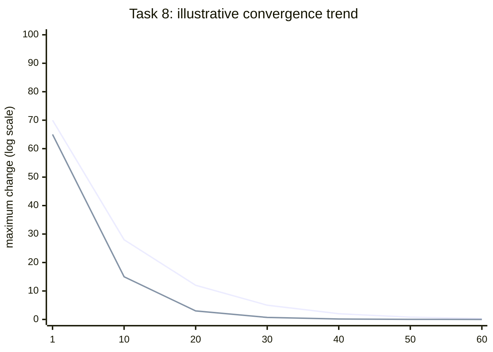
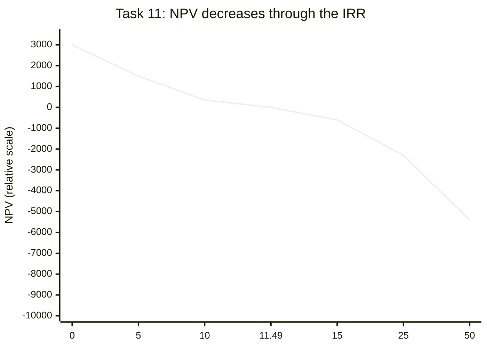
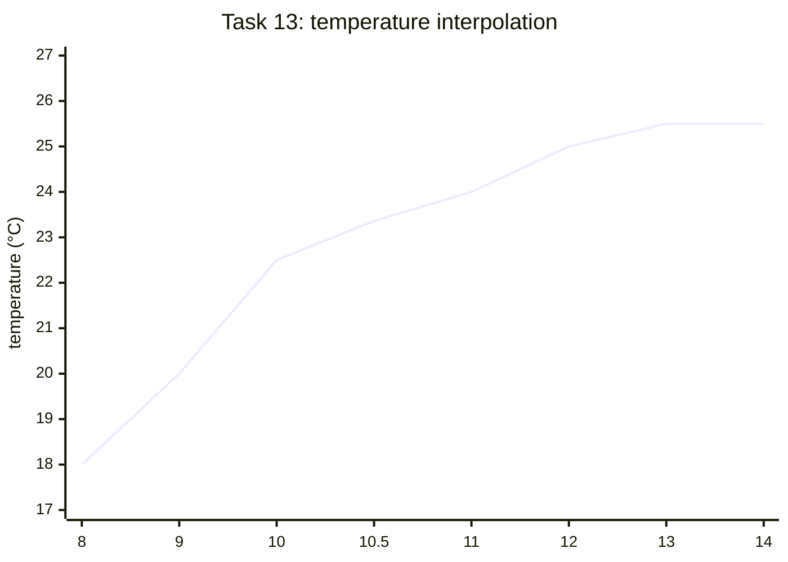
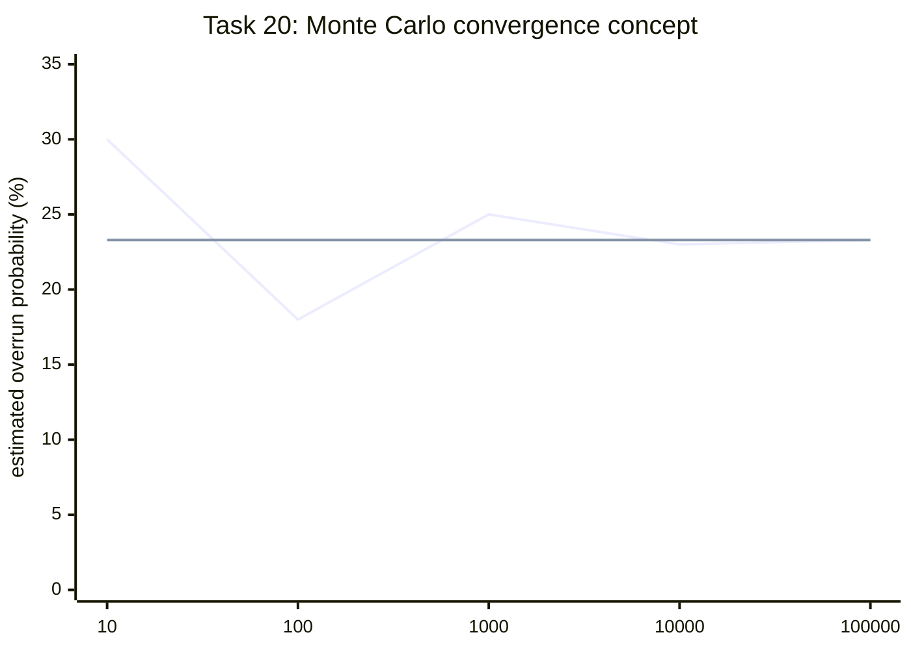

# BIT 2118 Scientific Computing 

This repository contains a cleaned, consolidated implementation of the scientific-computing work in the supplied report. The Python source includes the numerical method, parameter-sensitivity, real-world adaptation, and visualization work .


## Files

- [`BIT2118_Python_Codes_Tasks_01_to_20.py`](BIT2118_Python_Codes_Tasks_01_to_20.py) — one executable Python source file with explicit `TASK 01` through `TASK 20` section labels.

- `graphs/` — created automatically when the Python file is run; it contains PNG figures for the numerical results.


## Setup and execution

Python 3.9 or later is recommended. Install the dependencies:

```bash
python -m pip install numpy scipy matplotlib
```

Run all tasks from the directory containing the Python file:

```bash
python BIT2118_Python_Codes_Tasks_01_to_20.py
```

The program prints representative numerical results and writes graph files to graphs. The script uses a fixed random seed where random simulation is required, so the Monte Carlo result is reproducible.

## Actual graph images

The following figures are the actual generated PNG files. Every PNG currently produced by the Python file is included below.
### Tasks 1–5


### Tasks 8–12


### Tasks 13–20


## Task overview

| Task | Topic | Main operation | Generated graph |
| --- | --- | --- | --- |
| 1 | NumPy temperature arrays | Mean, extrema, Celsius-to-Fahrenheit transformation | `task_01_temperature.png` |
| 2 | Vectorization | Millisecond scaling and squared latency; loop benchmark | `task_02_vectorization.png` |
| 3 | Floating-point arithmetic | Equality, tolerance, absolute and relative error | — |
| 4 | Matrix algebra | Rotation, scaling, determinant, transformed coordinates | `task_04_matrix_transform.png` |
| 5 | Curve fitting | Quadratic least-squares response-time model | `task_05_curve_fit.png` |
| 6 | Linear systems | Solve `Ax=b` and residual verification | — |
| 7 | LU decomposition | Factor once and solve multiple right-hand sides | — |
| 8 | Iterative linear methods | Jacobi and Gauss–Seidel convergence | `task_08_iterative_convergence.png` |
| 9 | Eigenvalues and eigenvectors | Network-node importance scores | `task_09_eigen_scores.png` |
| 10 | Bisection and fixed point | Thermal equilibrium root | `task_10_bisection_root.png` |
| 11 | Newton–Raphson and secant | Investment IRR from NPV = 0 | `task_11_irr_npv.png` |
| 12 | Nonlinear systems | Circle/parabola intersections | `task_12_nonlinear_system.png` |
| 13 | Interpolation | Linear and cubic-spline temperature estimate | `task_13_interpolation.png` |
| 14 | Numerical differentiation | GPS position to speed | `task_14_differentiation.png` |
| 15 | Numerical integration | Power to energy using trapezoid and Simpson rules | `task_15_integration.png` |
| 16 | Euler’s method | Newton’s law of cooling | `task_16_euler_cooling.png` |
| 17 | Reserved report transition | Included in the consolidated ODE workflow | — |
| 18 | SciPy ODE integration | RC-circuit capacitor charging using `solve_ivp` | `task_17_scipy_rc.png` |
| 19 | Optimization | Continuous SLSQP and integer fleet allocation | `task_18_optimization.png` |
| 20 | Monte Carlo simulation | Construction-project budget-overrun probability | `task_19_monte_carlo.png` |

The original report presents Tasks 17 and 18 as the Euler and SciPy ODE sections. The source code keeps those methods in the same order; graph filenames are retained from the report-oriented implementation.

## Mathematical methods and interpretations

### Tasks 1–5: arrays, arithmetic, matrices, and fitting

Task 1 uses 24 hourly Celsius readings. The reproducible mean is approximately **23.1208 °C**, with a minimum of **17.50 °C** and a maximum of **29.40 °C**. Increasing the peak reading at index 12 to 35 °C raises the mean to approximately **23.3542 °C** while leaving the minimum unchanged. The Fahrenheit conversion is vectorized and preserves the order of the observations.

Task 2 compares explicit Python iteration with NumPy vectorization on one million simulated latency values. Vectorization avoids per-element Python interpreter overhead and should be substantially faster, although exact timing depends on the execution environment.

Task 3 demonstrates why `0.1 + 0.2 == 0.3` is false in binary floating-point arithmetic. `numpy.isclose` is appropriate for tolerance-based comparisons. Absolute error is

$$
|x_{true}-x_{approx}|
$$

and relative error is the absolute error divided by `|x_true|`. The same section recommends `Decimal` for currency calculations where cent-level decimal behavior matters.

Task 4 applies a 45° rotation and nonuniform scaling to the corners of a square. The determinant is approximately **3**, which means the transformation multiplies area by three. Task 5 fits a quadratic model to server response time as concurrent users increase; the curve rises more steeply at higher loads, so extrapolated predictions should be treated cautiously.

### Tasks 6–9: linear algebra

For Task 6, the system

$$
A x=b,\qquad A=\begin{bmatrix}4&2\\8&12\end{bmatrix},\quad b=\begin{bmatrix}20\\72\end{bmatrix}
$$

has solution `x = [3, 4]`. The residual `b - A @ x` verifies the result. Changing the second measurement to 96 changes the solution to approximately `[1.5, 7.0]`.

Task 7 reuses one LU factorization for several load vectors. This is efficient when `A` is fixed and many right-hand sides must be solved. Task 8 compares Jacobi with Gauss–Seidel for a diagonally dominant temperature system. Both methods converge to the direct solution, but Gauss–Seidel uses the newest values immediately and therefore reaches the tolerance in fewer iterations.

Task 9 computes the dominant eigenvector of a four-node adjacency matrix. After normalization, nodes B and C have the largest importance scores because they have stronger connectivity. The small verification norm confirms `Av ≈ λv` numerically.



### Tasks 10–12: nonlinear equations

Task 10 solves

$$
f(T)=T-25-10e^{-T/20}=0
$$

with bisection and fixed-point iteration. With the equation as written in the source file, both methods converge to approximately **27.525211 °C**. Bisection has predictable halving behavior; fixed-point convergence depends on the contraction factor near the root.

Task 11 finds the internal rate of return by solving `NPV(r)=0` for cash flows `[-10000, 3000, 3500, 4000, 2500]`. Newton–Raphson uses the analytical derivative, while the secant method estimates a slope from two previous points. Both converge to approximately **11.542461%** for these cash flows and produce an NPV close to zero.

Task 12 solves the circle/parabola system

$$
x^2+y^2=4,\qquad y=x^2-1.
$$

The two symmetric intersections are approximately `(1.5175, 1.3028)` and `(-1.5175, 1.3028)`. Initial guesses influence which root is returned.



### Tasks 13–15: interpolation, differentiation, and integration

Task 13 estimates the 10:30 temperature from hourly weather-station readings. Linear interpolation gives **23.250 °C**, while the cubic spline gives approximately **23.362 °C**. The difference arises because the spline uses the broader shape of the data rather than only the two neighboring values.

Task 14 estimates speed from GPS position samples. Forward, central, and backward differences are used at the beginning, interior, and end of the series. Changing the position at `t=3 s` does not change the central estimate at exactly `t=3 s`, but it does affect neighboring estimates.

Task 15 integrates smart-meter power readings. The original data give approximately **15.700 kWh** with the trapezoidal rule and **15.800 kWh** with Simpson’s rule. Raising the 6-hour power reading from 1.8 kW to 2.2 kW increases both estimates because the area under the power curve increases.



### Tasks 16–18: differential equations

Task 16 applies explicit Euler steps to Newton’s law of cooling,

$$
\frac{dT}{dt}=-k(T-T_{env}).
$$

The analytical solution is plotted alongside Euler solutions for several step sizes. Larger time steps produce greater truncation error; sufficiently large steps can also cause numerical instability.

Task 18 uses SciPy’s adaptive RK45 implementation through `solve_ivp` for an RC circuit:

$$
\frac{dV_C}{dt}=\frac{V_{in}-V_C}{RC}.
$$

Larger capacitance increases the time constant `τ=RC`, so the capacitor charges more slowly toward the input voltage.

### Tasks 19–20: optimization and Monte Carlo simulation

Task 19 minimizes fleet cost subject to a delivery-capacity constraint. Type A trucks cost $150 and carry 200 boxes; Type B trucks cost $250 and carry 400 boxes. The continuous solution may contain a fractional truck, so a nearby integer search is also performed. The best practical solution is **four Type B trucks**, providing 1,600 boxes at a cost of **$1,000**.

Task 20 simulates 100,000 independent construction-project cost scenarios using a fixed random seed. The three phases are normally distributed around $50,000, $80,000, and $40,000. The output estimates the probability that the total exceeds the $180,000 budget. In the supplied report, the corresponding result is approximately **23.3420%**; the exact count printed by the cleaned script is reproducible for the stated seed and NumPy version.



## Reproducibility and limitations

The timing benchmark in Task 2 varies with processor, Python version, NumPy build, and system load. Numerical outputs can differ in the final few digits across library versions. Random simulations are seeded, but normal random-number implementations should still be treated as version-sensitive. Curve fitting and extrapolation are model-dependent: a visually good fit inside the observed range does not guarantee accurate predictions outside it.

The generated PNG files are intentionally not required for running the script. They are produced locally by the source file so the repository remains easy to recreate from two primary deliverables.
